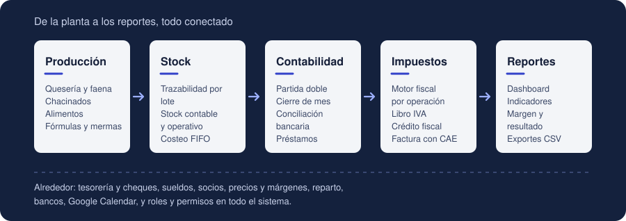

  

  
  
  

## ERP industrial a medida

Un ERP completo para una industria de alimentos: va desde la producción en planta hasta la contabilidad y los impuestos, con trazabilidad de punta a punta. Proyecto de equipo, en producción, desarrollado durante más de un año. Tiene más de 370 mil líneas de Python, más de 900 migraciones de base de datos y más de 850 archivos de test.

  

**Mi rol: QA y revisión técnica dentro del equipo.**

- Planificación de pruebas por sprint, cruzando datos de Jira con copias de la base para detectar inconsistencias antes de salir a producción.
- Diagnóstico de errores en producción, incluyendo fallas de esquemas y de conectividad con la base de datos gestionada.
- Revisión de pull requests con comentarios técnicos.
- Testing de la app móvil en React Native y depuración de entornos Docker y migraciones.

<b>Todo lo que cubre el sistema (13 áreas)</b>

 

| Área | Qué resuelve |
|---|---|
| **Producción industrial** | Quesería, faena, chacinados y alimentos. Fórmulas versionadas, plantillas de consumo de materia prima, mermas y controles de calidad de leche y producto terminado. |
| **Producción primaria** | Campañas, tickets de flujo operativo y activos biológicos con trazabilidad. |
| **Stock y trazabilidad** | Stock híbrido (contable y operativo, con reservas y en proceso), lotes de producción, producto terminado, merma y stock, recuento físico y costeo FIFO. |
| **Contabilidad** | Motor de partida doble, movimientos y submovimientos, cierre de mes y períodos, conciliación bancaria, activos fijos y en formación, préstamos, gastos con prorrateo y absorción de costos indirectos. |
| **Impuestos y facturación** | Motor fiscal que decide qué impuestos aplican a cada operación, crédito fiscal, Libro IVA, facturación electrónica (CAE) y doble circuito declarado / no declarado en los reportes. |
| **Tesorería** | Cuentas bancarias, caja, tarjetas y billeteras digitales, cartera de cheques, medios de pago y punto de venta con sesiones de caja y arqueo. |
| **Socios y sueldos** | Cuenta corriente de socios, aportes y retiros, y liquidación de sueldos con provisiones (SAC, vacaciones e indemnizaciones). |
| **Precios y márgenes** | Un único modelo de formación de precios: costo FIFO, valor agregado entre secciones y márgenes mayorista y minorista, con control de precios de los locales. |
| **Logística** | Reparto con ruteo, asignación y pedidos. |
| **Reportes y KPIs** | Dashboard con tablas, tarjetas y gráficos, exportes a CSV, motor de indicadores, margen bruto y resultado. |
| **Calidad y mantenimiento** | No conformidades ligadas a lotes y mantenimiento de equipos. |
| **Integraciones** | Bancos, Google Calendar, liquidación de sueldos externa y el sistema de ventas de los locales (SQL Server). |
| **Seguridad** | Usuarios, roles y permisos por sección, con autenticación JWT. |

<b>Cómo está construido por dentro</b>

 

- **Arquitectura en capas estricta:** Controller, Service, Repository y Model, con clases base genéricas que traen filtros dinámicos, paginación y precarga automática de relaciones.
- **Dinero sin errores de redondeo:** columnas `Numeric` (nunca `Float`) y aritmética monetaria con `Decimal`.
- **Herencia polimórfica** en el módulo contable para compras, ventas y transferencias internas.
- **Más de 900 migraciones** con Alembic y seeders versionados.
- **Más de 850 archivos de test** con aislamiento por transacción.
- **CI/CD con runner propio**, Docker y un bot de revisión de PRs con IA.
- **Documentación técnica extensa:** reglas de negocio, decisiones de arquitectura y criterios fiscales por escrito.

  
  
  
  
  
  

El código es privado. Si necesitás algo parecido para tu negocio, escribime.

## ViciosBurger, pedidos online para hamburguesería

Pensado para el celular: versión web instalable (PWA) y app móvil en React Native.

  

Código: [ViciosBurgerApp (PWA)](https://github.com/Frannkode/ViciosBurgerApp) y [ViciosBurger (React Native)](https://github.com/Frannkode/ViciosBurger).

## Qué puedo hacer por tu negocio

- **Tiendas online y e-commerce:** desde cero o sobre Tiendanube, con personalizaciones que la plataforma no trae (selectores de packs, SKUs dinámicos, lógica a medida).
- **Sistemas de gestión:** punto de venta (POS), control de stock y paneles con estadísticas para decidir con datos.
- **Pedidos online para gastronomía:** menú mobile-first, pedidos por WhatsApp y apps de delivery.
- **Webs y landing pages:** rápidas, responsive y pensadas para que te contacten.
- **Mejoras sobre lo que ya tenés:** arreglos, integraciones y nuevas funciones en tu sitio o sistema actual.

## Más proyectos

| Proyecto | Qué es |
|---|---|
| [**ReactVicios**](https://github.com/Frannkode/ReactVicios) | Menú mobile-first con pedidos por WhatsApp |
| [**ElCruceRestaurant**](https://github.com/Frannkode/ElCruceRestaurant) | Sitio de restaurante con React y Tailwind v4 |
| [**QuickOrder**](https://github.com/Frannkode/QuickOrder) | Sistema de pedidos en TypeScript |
| [**FullBebidas**](https://github.com/Frannkode/FullBebidas) | E-commerce de bebidas |
| [**Indumentaria**](https://github.com/Frannkode/Indumentaria) | E-commerce de ropa |
| [**MotoPartes**](https://github.com/Frannkode/MotoPartes) | E-commerce de repuestos de moto |

Más trabajos en mi [portfolio](https://frannkode.vercel.app).

## Tecnologías

  
  
  
  
  
  
  
  
  
  
  
  
  
  
  

## Cómo trabajo

1. **Charlamos y definimos qué necesitás.** Sin tecnicismos, con un alcance claro.
2. **Entregas por etapas.** Ves avances reales y decidimos juntos en cada paso.
3. **Lanzamiento y soporte.** Te acompaño después de publicar.

  <b>¿Tenés un proyecto en mente?</b> 
  Contame qué necesitás y te respondo con una propuesta.  
  

